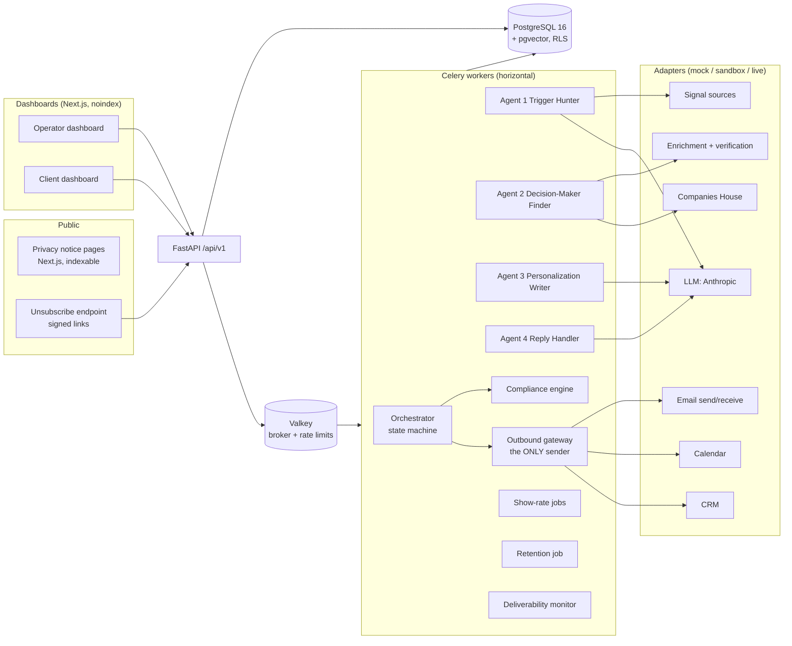
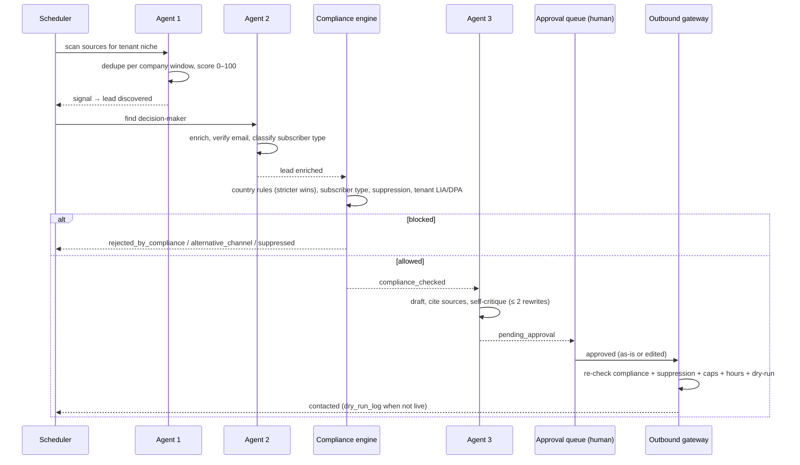

# 01 — System Architecture

Status: **Proposed (Phase 1)** · Last updated: 2026-10-12

> Legal statements in this document are engineering assumptions, not legal advice.
> Every legal rule is encoded as configuration with `verified_by_counsel: false`.

## 1. Goals that drive the design

| Priority | Goal | Design consequence |
|---|---|---|
| 1 | Never send an unlawful or unwanted email | A single outbound gateway; compliance and suppression checked at queue time **and** at send time; DB trigger backs up code checks |
| 2 | Never cause an external side effect by accident | Dry-run by default; real effects only behind a three-key switch (adapter, tenant, global go-live) |
| 3 | Never send a duplicate | Idempotency keys + unique constraints + at-most-once send semantics |
| 4 | Protect PII | Encryption at rest, masking by default, logged unmasking, synthetic data outside production |
| 5 | Optimise for attended, qualified meetings | Human approval queue, show-rate workflows, billing tied to an evidence chain |
| 6 | Lean cost | Open-source stack, one Postgres, one Redis-compatible broker, no paid dependency before Phase 6 |

## 2. Component overview

### 2.1 Processes

| Process | Tech | Scales | Notes |
|---|---|---|---|
| `api` | FastAPI + Uvicorn | Horizontally | Stateless; sessions in Postgres |
| `worker-default` | Celery | Horizontally | Agents 1–3, enrichment, orchestration |
| `worker-replies` | Celery, dedicated queue | Horizontally | Agent 4; isolated so the ≤ 5 min reply SLA isn't starved by bulk work |
| `worker-send` | Celery, dedicated queue | Horizontally, serialised per inbox | Outbound gateway only |
| `beat` | Celery beat | **Single instance** | Reminders, retention, deliverability checks, adequacy-expiry warning |
| `web` | Next.js (App Router) | Horizontally | Dashboards + public privacy pages |
| `postgres` | PostgreSQL 16 + pgvector | Vertically; read replica later | Single source of truth |
| `valkey` | Valkey 8 (BSD-licensed Redis fork) | Single node for MVP | Broker, rate-limit counters, locks. **Never the source of truth** |

## 3. Key architectural rules

### R1 — The outbound gateway is the only code that can send

- Only `backend/app/domain/outbound/gateway.py` may import the email-send, calendar-write and CRM-write adapters. Enforced by an **import-linter contract** in CI; a violation fails the build.
- `gateway.send(message_id)` re-runs, inside one DB transaction with `SELECT … FOR UPDATE`:
  1. the compliance engine (fresh decision, current rule version),
  2. the global suppression check,
  3. tenant gates (LIA present, DPA signed, tenant not paused),
  4. deliverability gates (inbox healthy, caps not reached, recipient's local business hours, not a local bank holiday),
  5. the dry-run switch.
- A **database trigger** refuses to set `messages.status = 'sent'` unless the row references a `compliance_decisions` row with `outcome = 'allow'` created ≤ 15 minutes earlier **and** a suppression-check timestamp in the same window. This holds even for a raw SQL session using the application role.
- There is no "manual send" path that skips the gateway. Operator manual sends create a message and call the gateway. The operator's own (dogfooding) tenant is an ordinary tenant.

### R2 — Three-key live switch (dry-run by default)

A real side effect happens only when **all three** are true:

1. The adapter is configured `mode=live` (env var, per adapter).
2. The tenant has `live_mode = true` (set by an operator, audited).
3. `GLOBAL_GO_LIVE=true` **and** every go-live checklist item is signed off by the operator in the dashboard (never by code).

Otherwise the gateway routes to `DryRunAdapter`, which writes the full would-be payload to `dry_run_log` and returns a synthetic provider ID. Every test and demo runs this way.

### R3 — Agents decide nothing irreversible

LLM agents only *produce validated data* (scores, drafts, classifications). Deterministic orchestrator code makes every decision with side effects (send, suppress, book, bill). Untrusted content (web pages, replies) can influence text, never actions. Safety-critical classifications (unsubscribe, data-protection request) are also detected by deterministic rules; the system acts if **either** the rules **or** the LLM flag them. See `06-threat-model.md`.

### R4 — Tenant isolation in the database

Postgres Row-Level Security on every tenant-owned table, keyed by `current_setting('app.tenant_id')` set with `SET LOCAL` per transaction. The app connects as a role **without** `BYPASSRLS` and is not the table owner. Operator cross-tenant reads use a separate policy requiring `app.role = 'operator'` and are audited. `suppression_list` is the only cross-tenant table and holds only keyed hashes. See ADR-0003.

### R5 — Durable, idempotent work

- Every job and external call carries an idempotency key; uniqueness enforced in Postgres (`idempotency_keys` table + domain unique constraints).
- Transactional **outbox**: state changes and "next work" are written in the same transaction; a relay enqueues Celery tasks. If the broker loses data, the outbox replays.
- Sending is **at-most-once**: a message moves `queued → sending` under a row lock before the provider call. If a worker crashes mid-call, the message goes to `needs_reconciliation` and is **never auto-resent**; the reconciler queries the provider by idempotency key, otherwise a human decides. A missing email is recoverable; a duplicate is not.

## 4. Main data flows

### 4.1 Outreach (Phase 3 vertical slice)

### 4.2 Replies, booking, show rate (Phase 4)

Inbound mail → `replies` (raw body encrypted) → deterministic safety rules **and** Agent 4 classify → orchestrator acts:

- `unsubscribe` / `data_protection_request` / objection → **global suppression in the same transaction**, data-protection request record with one-month deadline and regime (UK GDPR / EU GDPR), drafted response for human approval, tenant contact notified.
- `interested` → qualification with evidence → slot offer from real availability → booking via gateway → confirmation + reminders + pre-meeting brief.
- `out_of_office` → pause sequence until return date + 1 business day.
- `referral` → new prospect, full enrichment and compliance re-run.
- confidence < 0.70, anger, legal/pricing/contract, complaint, off-playbook → `escalated`.

### 4.3 Billing (Phase 5)

`attended` + qualification evidence meets the tenant's signed criteria + booked by system → billable line → invoice (GBP/EUR) → tenant may dispute → resolution recorded. Each line stores the evidence-chain IDs (signal → lead → messages → replies → qualification → meeting → attendance).

## 5. Deployment topology (target, Phase 6)

- UK region (AWS eu-west-2 London, Azure UK South, or UK VPS). Final provider chosen in Phase 6 with cost comparison.
- Postgres and Valkey on a private network; only `web` and `api` exposed behind TLS.
- Secrets in the provider's secret manager; `.env` only for local dev.
- Daily encrypted Postgres backups in the same UK region; restore drill before go-live.

## 6. International access (Tunisia)

| Environment | Data | Access from Tunisia |
|---|---|---|
| Local dev | **Synthetic only** (Faker, `.example` / `.test` domains) | Yes |
| CI | Synthetic only | n/a |
| Staging | Synthetic only | Yes |
| Production | Real PII | Only with MFA, RBAC, access logging, masking by default, **and** a documented transfer mechanism (UK IDTA / EU SCCs + transfer risk assessment) signed off on the go-live checklist |

Production PII is never copied to dev or staging. There is no "restore prod into staging" tooling, by design.

## 7. Configuration model

- **Runtime settings**: environment variables (Pydantic Settings), documented in `.env.example`.
- **Business/legal configuration** (countries, tax, footer templates, holiday overrides): versioned YAML in `config/`, loaded into versioned, immutable DB rows by `pipelineos config sync`. A change creates a new version; every decision records the version used.
- **Tenant configuration**: `tenant_configs`, versioned JSONB validated by a Pydantic schema.
- **Prompts**: `prompts/<agent>/v<N>.md` with front-matter; the file's SHA-256 is logged with every LLM call.

## 8. Explicit non-goals for MVP

- No LinkedIn automation or scraping of any kind (the system only *creates* human-executed tasks).
- No self-serve tenant signup.
- No open/click tracking by default.
- No sending without human approval during a tenant's first 2 weeks.
