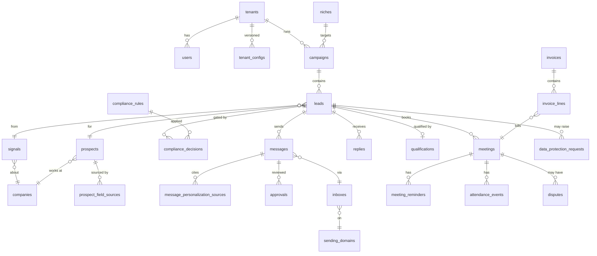

# 03 — Data Model

Status: **Proposed (Phase 1)** · Target: PostgreSQL 16 + pgvector · Migrations: Alembic (reversible where possible; applied migrations never edited)

## 1. Conventions

- PK `id uuid DEFAULT gen_random_uuid()` (UUIDv7 generated in app where ordering matters).
- `created_at`, `updated_at timestamptz NOT NULL DEFAULT now()`; all times stored UTC; IANA time zone stored where local time matters.
- Tenant-owned tables: `tenant_id uuid NOT NULL REFERENCES tenants`, RLS `ENABLE` + `FORCE` (ADR-0003), and **every FK column indexed**.
- PII columns end in `_enc` (bytea, AES-GCM envelope) with optional `_bidx` (HMAC blind index) — ADR-0005.
- Money: `amount_minor bigint` + `currency char(3)` (`GBP`/`EUR`). Never floats.
- Enumerations: Postgres `text` + `CHECK` constraints (easier to evolve than native enums).
- Versioned config tables are **append-only** (UPDATE/DELETE revoked from `pipelineos_app`).
- `audit_log`, `pii_access_log`, `compliance_decisions`, `dry_run_log`, `llm_calls` are append-only.

Legend: **[T]** tenant-scoped (RLS) · **[G]** global · **[A]** append-only · **[V]** versioned · 🔒 contains encrypted PII.

## 2. Entity-relationship overview

## 3. Tables (the 33 required + supporting)

### 3.1 Tenancy & identity

**tenants** [G] — `id, legal_name, company_number, registered_address, country_code, vat_number, status (onboarding|active|paused|offboarded), is_operator_own (bool, dogfooding), live_mode (bool default false), approval_mode (always|sampling), approval_sample_pct (int 0–100, default 100), approval_mode_locked_until (date, default created+14d), billing_currency (GBP|EUR), lia_reference, lia_document_url, lia_approved_at, dpa_status (none|sent|signed), dpa_signed_at, dpa_version, role (controller|processor_client), eu_representative (jsonb: name, contact_email, country_code, address, recorded_at; GDPR Article 27, operator-recorded, migration 0012)`.
- CHECK: `approval_mode='always' OR now() > approval_mode_locked_until` enforced in app + trigger.
- Not under RLS (operator-managed), but tenant users can read only their own row via a view.

**users** [G, scoped by `tenant_id NULL` for operators] — `id, tenant_id NULL, email_bidx UNIQUE, email_enc 🔒, name_enc 🔒, password_hash, role (operator|tenant_admin|tenant_viewer), mfa_secret_enc, mfa_enabled, status, last_login_at`. CHECK: `role='operator' ⇒ tenant_id IS NULL AND mfa_enabled` (enforced at login).

**sessions** (supporting) [G] — `id (hash of token), user_id, created_at, last_seen_at, expires_at, ip_country, user_agent_hash, mfa_verified_at`.

**tenant_configs** [T, V] — `id, tenant_id, version, config jsonb, schema_version, created_by, created_at`. UNIQUE `(tenant_id, version)`. Holds ICP, personas, target countries, languages, brand voice, objection playbook, qualification framework + criteria, calendar connection ref, reminder offsets, daily caps, sequence settings, AI-disclosure settings, retention days. The **signed qualification criteria** are referenced by version from qualifications and invoice lines.

**niches** [G] — `id, slug UNIQUE, name, description, icp_template jsonb, persona_templates jsonb, playbook_template jsonb`. Reusable vertical playbooks shared across tenants (no PII).

**campaigns** [T] — `id, tenant_id, niche_id, name, status (draft|active|paused|auto_paused|completed), paused_reason, target_countries text[], language, sequence_config jsonb, daily_cap, started_at`. Index `(tenant_id, status)`.

### 3.2 Signals, companies, prospects, leads

**companies** [T] — `id, tenant_id, name, domain, domain_normalised, country_code, company_number, legal_form (ltd|plc|llp|lp|partnership|sole_trader|public_body|charity|unknown), legal_form_source, size_band, industry_codes text[], embedding vector(1024) NULL`. UNIQUE `(tenant_id, domain_normalised)`. Companies are not personal data, but sole-trader company names may be → treated as PII when `legal_form IN (sole_trader, partnership)` (name encrypted, flag set).

**signals** [T] — `id, tenant_id, company_id, campaign_id, source_adapter, source_url, signal_type (job_posting|leadership_change|funding|expansion|product_launch|tech_change|tender|other), signal_summary, detected_at, relevance_score smallint CHECK 0–100, reasoning, raw_ref, dedupe_key`. UNIQUE `(tenant_id, dedupe_key)` where `dedupe_key = hash(company_id, signal_type, window_bucket)`. Index `(tenant_id, detected_at DESC)`.

**prospects** [T] 🔒 — `id, tenant_id, company_id, name_enc, title, email_enc, email_bidx, profile_url_enc, country_code, location_country_code, subscriber_type (corporate|individual|unknown), subscriber_type_reason, email_verification (valid|risky|invalid|unknown), email_verified_at, collected_at, confidence_score numeric(3,2), anonymised_at`. **UNIQUE `(tenant_id, email_bidx)`** — no duplicate prospect per tenant. Index `(tenant_id, company_id)`.

**prospect_field_sources** [T] — `id, tenant_id, prospect_id, field_name, data_source (adapter + record id), source_url, collected_at, lawful_basis_note`. UNIQUE `(prospect_id, field_name, data_source)`.

**leads** (supporting, central) [T] — `id, tenant_id, campaign_id, prospect_id NULL, company_id, signal_id, state, state_changed_at, version int, paused_until, escalation_id NULL, objected_after_booking bool, correlation_id`. UNIQUE `(campaign_id, prospect_id)`. Index `(tenant_id, state, state_changed_at DESC)` for dashboard pipeline (100k leads < 2s), partial index on `paused_until IS NOT NULL`.

### 3.3 Compliance

**compliance_rules** [G, V, A] — `id, country_code, version, mode (permitted_with_opt_out|consent_required|restricted_review), allowed_channels text[], subscriber_rules jsonb, regime (uk_gdpr|eu_gdpr), notes, source, verified_by_counsel bool default false, verified_by, last_reviewed date, effective_from, content_hash`. UNIQUE `(country_code, version)`.

**compliance_decisions** [T, A] — `id, tenant_id, lead_id, message_id NULL, stage (queue|send|referral|recheck), outcome (allow|block|alternative_channel), reason_codes text[], rules_applied jsonb (country → rule id/version), effective_country_code, suppression_checked_at, engine_version, created_at`. Index `(lead_id, created_at DESC)`.

**country_rollout_status** [G, V] — `id, country_code, version, stage (0–4|restricted), enabled bool default false, enabled_by, enabled_at, languages text[], currency, time_zones text[], holiday_calendars text[], eu_representative_required bool, notes`.

**suppression_list** [G — the only cross-tenant table] — `id, identifier_hash UNIQUE (HMAC with SUPPRESSION_HASH_KEY), identifier_type (email|domain), scope (global|tenant), tenant_id NULL, reason (unsubscribe|objection|erasure|complaint|bounce_hard|manual), source_ref, created_at`. No plaintext ever. CHECK `scope='tenant' ⇔ tenant_id IS NOT NULL`. Never deleted (DELETE revoked).

**data_protection_requests** [T] 🔒 — `id, tenant_id, lead_id NULL, prospect_ref_hash, request_type (access|erasure|objection|rectification|restriction|portability|unsubscribe|unclear), regime (uk_gdpr|eu_gdpr), received_at, deadline_at (received + 1 calendar month, computed per regime config), extended_deadline_at NULL, status (open|in_progress|awaiting_tenant|completed|refused_with_reason), response_draft_enc, responded_at, handled_by, controller (tenant|operator)`. Index `(status, deadline_at)`.

**alternative_channel_tasks** (supporting) [T] — `id, tenant_id, lead_id, channel (linkedin_manual|warm_intro|event|inbound_content), instructions, assigned_to, status, due_at`. Human-executed only.

### 3.4 Sending & deliverability

**sending_domains** [T] — `id, tenant_id, domain UNIQUE, is_tenant_primary bool CHECK = false, spf_ok, dkim_ok, dmarc_ok, dmarc_policy, verified_at, warmup_stage, health_score, status (setup|warming|active|paused)`.

**inboxes** [T] — `id, tenant_id, sending_domain_id, address UNIQUE, display_name, provider, oauth_token_enc 🔒 NULL, oauth_status (ok|expired|revoked), daily_cap int CHECK ≤ 50, warmup_day, health_score, status`.

**deliverability_metrics** [T] — `id, tenant_id, inbox_id NULL, sending_domain_id NULL, campaign_id NULL, date, sent, delivered, bounced_hard, bounced_soft, complaints, replies, bounce_rate numeric, complaint_rate numeric`. UNIQUE `(inbox_id, date)`. Kill-switch evaluated from rolling window.

**messages** [T] 🔒 — `id, tenant_id, lead_id, campaign_id, inbox_id NULL, sequence_step smallint, language, subject_enc, body_enc, compliance_footer, quality_score numeric(3,1), critique jsonb, prompt_version, status (see state machine), idempotency_key UNIQUE, send_compliance_decision_id, suppression_checked_at, scheduled_for, sent_at, provider_message_id, mode_at_send (dry_run|sandbox|live), unsubscribe_token_id`. **UNIQUE `(lead_id, sequence_step)` partial where status in (sent, dry_run_sent, sending)** → no duplicate sends. Trigger: send gate (ADR-0004).

**message_personalization_sources** [T] — `id, tenant_id, message_id, claim_text, source_url, source_type, retrieved_at, source_snapshot_hash`. Every claim → one row; validator guarantees count ≥ number of claims.

**approvals** [T] — `id, tenant_id, message_id, reviewer_id, decision (approved|edited|rejected), original_body_enc, edited_body_enc NULL, diff, reason, review_seconds int, created_at`.

**dry_run_log** (supporting) [T, A] — `id, tenant_id, effect_type (email_send|calendar_create|calendar_update|calendar_cancel|crm_write|paid_api_call), adapter, idempotency_key, payload_enc, recipient_bidx, created_at`.

**unsubscribe_tokens** (supporting) [T] — `id, tenant_id, message_id, prospect_ref_hash, expires_at NULL, used_at`. The link carries a signed token (HMAC-SHA256 over id + tenant + version, key `UNSUBSCRIBE_SIGNING_KEY`); tamper → 400 and logged; one-click (RFC 8058 `List-Unsubscribe-Post`).

### 3.5 Replies, qualification, meetings

**replies** [T] 🔒 — `id, tenant_id, lead_id, message_id NULL, received_at, from_bidx, raw_enc, body_text_enc, detected_language, classification, confidence, rule_flags text[], ooo_return_date, extracted_referral jsonb NULL, classified_at, prompt_version`. Index `(tenant_id, received_at DESC)`, partial on `classified_at IS NULL` (SLA monitor).

**escalations** (supporting) [T] — `id, tenant_id, lead_id, reason (anger|legal|pricing|contract|complaint|low_confidence|off_playbook|llm_failure|reschedule_limit|other), context jsonb, pre_escalation_state, status, assigned_to, resolved_at, resolution`.

**qualifications** [T] — `id, tenant_id, lead_id UNIQUE, framework (bant|meddic|custom), criteria_version (FK tenant_configs), evidence jsonb (criterion → {met, quote_ref, reply_id}), overall_met bool, confidence, decided_by (agent|human)`.

**meetings** [T] — `id, tenant_id, lead_id, calendar_provider, provider_event_id, starts_at, ends_at, prospect_tz, host_tz, status, booked_by_system bool, reschedule_count, reschedule_token_id, brief_enc, idempotency_key UNIQUE`. Partial UNIQUE `(lead_id) WHERE status IN (booked, confirmed)`.

**meeting_reminders** [T] — `id, tenant_id, meeting_id, offset_minutes, channel, scheduled_for, status (scheduled|sent|dry_run_sent|cancelled), idempotency_key UNIQUE`.

**attendance_events** [T] — `id, tenant_id, meeting_id, source (calendar|crm|tenant_confirmation|operator), status (attended|no_show|cancelled), recorded_by, recorded_at, evidence jsonb`.

**crm_connections** [T] (Phase 6.3) — `id, tenant_id (unique), provider (hubspot), token_enc, pipeline_id, stage_map jsonb (booked|confirmed|attended|no_show|cancelled → the client's stage ids), status (connected|disconnected), connected_by, disconnected_reason, last_sync_at`. The token is write-only (never returned by the API). Written by the client's admin or the operator; never deleted.

**crm_links** [T] (Phase 6.3) — `id, tenant_id, meeting_id (unique), provider, company_ext_id, contact_ext_id, deal_ext_id, synced_status, synced_mode (dry_run|live), state (pending|creating|ok|skipped|error), attempts, last_error, synced_at`. CRM object ids only, no personal data; written by the system only.

**disputes** [T] — `id, tenant_id, meeting_id, invoice_line_id NULL, raised_by, reason, status (open|upheld|rejected), resolution_note, resolved_by, resolved_at`.

### 3.6 Billing & tax

**invoices** [T] — `id, tenant_id, number UNIQUE (sequential per issuer), issue_date, due_date, currency, supplier_snapshot jsonb (name, company number, address, VAT no.), customer_snapshot jsonb (incl. VAT no.), place_of_supply, tax_rule_id, tax_wording, subtotal_minor, tax_minor, total_minor, status (draft|issued|paid|void)`.

**invoice_lines** (supporting) [T] — `id, tenant_id, invoice_id, kind (setup|retainer|meeting|credit), meeting_id NULL UNIQUE, description, amount_minor, evidence jsonb (signal_id, lead_id, message_ids, reply_ids, qualification_id, meeting_id, attendance_event_id)`.

**tax_rules** [G, V, A] — `id, version, code (uk_vat_standard|uk_not_registered|eu_b2b_reverse_charge|…), applies_when jsonb, rate_bps, invoice_wording, verified_by_accountant bool default false, last_reviewed, source`.
- Also stores `uk_vat_registration_threshold_minor` in a `tax_settings` row (value from config, `verified_by_accountant=false`); turnover tracker warns at 80% / 90%.

### 3.7 Governance

**sub_processors** [G] — `id, name, purpose, data_categories text[], location, transfer_mechanism_id, dpa_url, status, added_at`.

**transfer_mechanisms** [G] — `id, kind (uk_adequacy|eu_uk_adequacy|uk_idta|uk_addendum|eu_scc|none), description, counterparty, valid_until, tra_document_url, verified_by_counsel bool default false`. Seed: EU→UK adequacy `valid_until = 2031-12-27`; beat job warns from 2030-12-27.

**golive_checklist_items** (supporting) [G] — `id, scope (uk|eu_stage2|eu_stage3|country:XX), key, title, description, signed_off_by NULL, signed_off_at NULL, evidence_url`. **App role cannot set `signed_off_*` except through the operator sign-off endpoint (MFA re-prompt).** Code never seeds them as complete.

**pii_access_log** [G, A] — `id, user_id, tenant_id, lead_id, prospect_id, action (unmask|export|view_raw_reply), reason, ip_country, created_at`.

**audit_log** [G, A] — `id, tenant_id NULL, actor_type (user|system|agent), actor_id, action, entity_type, entity_id, before jsonb, after jsonb (PII-free), correlation_id, created_at`. Partitioned by month (pg native) for scale. BRIN index on `created_at`.

**llm_calls** [T, A] — `id, tenant_id, lead_id NULL, agent, prompt_id, prompt_version, prompt_hash, model, input_tokens, output_tokens, cost_minor (GBP pence ×100 precision), latency_ms, attempt, outcome, validation_errors jsonb, request_enc NULL, response_enc NULL, created_at`. Index `(tenant_id, created_at)`.

### 3.8 Workflow infrastructure (supporting)

**outbox** — `id, topic, payload jsonb, created_at, dispatched_at NULL, attempts`. Partial index on `dispatched_at IS NULL`.
**idempotency_keys** — `key PK, scope, request_hash, response jsonb, created_at, expires_at`.
**scheduled_actions** — `id, tenant_id, lead_id, action, run_at, status, idempotency_key UNIQUE`. Index `(status, run_at)`.

## 4. Requirement coverage

All 33 required tables are present: tenants, users, tenant_configs, niches, signals, companies, prospects, prospect_field_sources, compliance_rules, compliance_decisions, country_rollout_status, campaigns, sending_domains, inboxes, deliverability_metrics, messages, message_personalization_sources, approvals, replies, qualifications, meetings, meeting_reminders, attendance_events, disputes, invoices, tax_rules, suppression_list, data_protection_requests, sub_processors, transfer_mechanisms, pii_access_log, audit_log, llm_calls.

Supporting tables added: tenant_keys (wrapped per-tenant data keys, ADR-0005/0009), sessions, leads, alternative_channel_tasks, dry_run_log, unsubscribe_tokens, escalations, invoice_lines, tax_settings, golive_checklist_items, outbox, idempotency_keys, scheduled_actions.

## 5. Retention (defaults, configurable per tenant; flagged for legal review)

| Data | Default | Action |
|---|---|---|
| Non-converted prospects (no reply) | 180 days after last activity | Anonymise prospect + crypto-shred PII; keep aggregate metrics |
| Replies of disqualified leads | 180 days | Delete body, keep classification |
| Converted (meeting) leads | Contract term + 6 years (billing evidence) | Flag for accountant/solicitor confirmation |
| `llm_calls` bodies | 30 days | Null `request_enc` / `response_enc` |
| `dry_run_log` payloads | 90 days | Null `payload_enc` |
| Suppression hashes | Permanent | Never deleted |
| `audit_log` | 6 years | Partition drop after export (requires operator approval) |

**register_companies / register_names** [reference, not tenant data; migration 0013] — local copies of public registers published as open-data files (Belgium KBO/BCE, Ireland CRO). `register_companies(country_code, company_number, form_code, legal_form, status, extract_date, imported_at)`, `register_names(country_code, company_number, name, name_norm)`. Legal persons only, no addresses. Application role: SELECT only; written by the owner's import command; imports never delete (missing companies become `not_in_extract`).

**inbound_seen** [T, migration 0014] — `tenant_id, message_hash (HMAC of the Message-ID, per tenant), seen_at`. Records that an inbound message from an unknown sender was handled, so a duplicate push or the 15-minute safety sweep never handles it twice. Nothing readable is stored.

**inbox_placement_checks** [T, append-only, migration 0025] — `inbox_id, score (0–10, optional), spf_pass, dkim_pass, dmarc_pass, blacklisted, provider_results (jsonb: mailbox → inbox|spam|promotions|missing), evidence_url (https), passed, reasons, recorded_by, created_at`. Results of the go-live runbook's placement check (C2); pass/fail decided by the server's rule; operators write, nobody edits.

**provider_usage** [global, migration 0026] — `provider, period (YYYY-MM), calls, updated_at`. Monthly count of billed calls per paid provider (Google Places), incremented atomically under the cap before each call. Counts only; the system role writes, operators read.

**company_searches** [T, migration 0027] — `query, country (GB|FR), pages (1–3), status (queued|running|done|dry_run|failed), called_google, report (jsonb: counts, stopped_early, found: register name and number, verified domain, generic business address), error, requested_by, created_at, finished_at`. "Find companies" searches from the console. Operators insert; only the worker (system role) updates; never deleted by the app. Nothing Google returned is stored.
